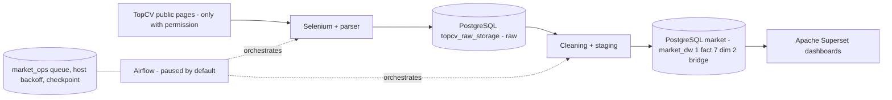

# Project1_VuDinhDong — TopCV IT Job Market Data Pipeline

> **Release 2026-11-08 — HARDENED / OFFLINE TESTED / NOT PRODUCTION CERTIFIED.**
> This repository is a real, runnable application scaffold, not evidence that TopCV allows automated collection or that 20 scopes can currently be collected. All live source collection is **disabled by default**. See [testing status](docs/05_Testing_and_Open_Gates.md).

## Architecture



- **Raw DB:** `topcv_raw_storage`, schema `raw`, six physical tables. Append-only observations preserve history, errors and source provenance.
- **Serving DW:** database `market` on the container PostgreSQL (host port 55440); schemas `staging`, `market_dw`, `market_ops`. The DW has 1 Fact + 7 Dimensions + 2 Bridges, **not** exactly the frozen historical `t4_dw` B3 prototype.
- **Airflow DAGs:** `topcv_market_pipeline` (daily **19:00 Asia/Ho_Chi_Minh**); `topcv_scopes_recovery` (30-minute due-retry); `topcv_warehouse_recovery` (warehouse-only recovery). **All are paused upon creation**, and existing deployments must be paused manually.
- **Dashboard:** Apache Superset, typically `http://localhost:8090` after explicitly deploying its isolated compose project.

## Quick start — Windows PowerShell, supervised/test-only

Requirements: Windows 10/11, Python 3.12, Docker Desktop with Compose, PostgreSQL Raw database, permissions for database connections. Do not run live crawl until source access is authorized.

```powershell
# Project root after extracting ZIP (a single Project1_VuDinhDong folder)
py -3.12 -m venv .venv312
.\.venv312\Scripts\python.exe -m pip install -r requirements.txt
Copy-Item .env.example .env
# Fill only .env with the Raw database URL; never commit or share it.
.\.venv312\Scripts\python.exe -m scripts.prepare_market_runtime
.\.venv312\Scripts\python.exe -m scripts.preflight_release

# Bootstrap only the private market-db service. This does NOT crawl TopCV.
docker compose --env-file .env.market -f airflow/docker-compose.market.yml up -d market-db
# Explicit schema bootstrap (first run or on a verified clone after backup).
.\.venv312\Scripts\python.exe -m scripts.run_market_pipeline initialize
# Run Airflow, DAGs are still paused.
docker compose --env-file .env.market -f airflow/docker-compose.market.yml up -d --build
.\.venv312\Scripts\python.exe -m scripts.run_market_pipeline plan
.\.venv312\Scripts\python.exe -m scripts.run_market_pipeline status
```

**Existing database:** Never initialize/reprocess over an unverified schema. First run `python -m scripts.preflight_release --database`; if it reports drift, use a database clone and a reviewed migration rather than automatic destructive repairs.

## Testing (safe by default)

```powershell
.\.venv312\Scripts\python.exe -m unittest discover -s tests -p "test_*.py" -v
.\.venv312\Scripts\python.exe -m scripts.preflight_release
```

Real PostgreSQL integration tests are **destructive to the named test DB** `market_integration_test` and are skipped until `MARKET_TEST_DSN` is explicitly configured. Do not point them to any production DB. See [testing guidance](docs/05_Testing_and_Open_Gates.md).

## Live collection policy

Live collection is **off** unless `TOPCV_LIVE_COLLECTION_APPROVED=YES` **and** a nonsecret `TOPCV_SOURCE_AUTHORIZATION_REFERENCE` are both provided to the environment after obtaining a suitable authorization. Those flags do not themselves constitute permission. Selenium does not solve challenges. Source rate limits, 403, 429 and incomplete route verification must be honored. This release does not include proxies or CAPTCHA bypass. Since 2026-11-13 it includes one opt-in exception to "no browser fingerprint concealment": `--browser-driver undetected` (operator decision; default off, see [docs/08](docs/08_Undetected_Chrome_VI.md)).

## Documents

- [01 — Architecture & contracts](docs/01_Architecture_and_Contracts.md)
- [02 — Data flow & analytics semantics](docs/02_Data_Flow_and_Metrics.md)
- [03 — Deployment & recovery](docs/03_Deploy_and_Recovery.md)
- [04 — Airflow, Docker, Superset](docs/04_Orchestration_and_BI.md)
- [05 — Tests, evidence and open gates](docs/05_Testing_and_Open_Gates.md)
- [06 — Hướng dẫn chạy kiểm thử live E2E trên Windows](docs/06_Live_E2E_Runbook_VI.md)
- [README — Raw Storage](docs/raw_storage/README.md)
- [README — Data Warehouse](docs/data_warehouse/README.md)

## Safety and handover

Secrets and browser profiles are excluded from the ZIP. Set runtime variables locally, do not distribute `.env`, `.env.market`, Chrome profiles, DB dumps or logs. Use `python -m scripts.build_clean_release --output ../Project1_VuDinhDong_Release.zip` to rebuild a secret-free ZIP after regression. The build script requires output outside the project root.

**Status:** Offline unit/negative tests PASS; PostgreSQL, Docker, Airflow runtime, Superset, live 20/20 coverage and scheduled 19:00 execution are **NOT VERIFIED** in the current packaging environment. No claim of 100% production readiness is made.
