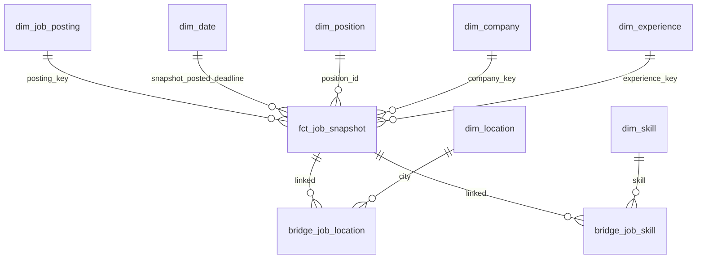

# Data Warehouse Architecture — serving `market_dw` (B3-derived)

> The current production-design layer is the `market` PostgreSQL DB with schemas `staging`, `market_dw` and `market_ops`. Its 10 physical B3-derived tables are **not identical** to the historical 22-column `t4_dw` B3 prototype; do not apply old prototype SQL to this database.

## Layers

- `staging.job_observations_clean`: 45-field normalized observation, keyed by Raw provenance.
- `market_dw`: **1 Fact + 7 Dimensions + 2 Bridges** (51 Fact columns after the additional `lifecycle_status`), a star schema with many-to-many extensions.
- `market_ops`: `scope_queue`, `host_backoff`, `mapping_errors`, `refresh_checkpoint`, `refresh_log` for operations/checkpoints. **Not dimensions/facts.**

## Data model — 10 tables

| Table | Identity | Purpose |
|---|---|---|
| **`fct_job_snapshot`** | PK `(posting_natural_key,crawl_run_id)`; `raw_job_id` unique | One posting per capture run, measures and provenance |
| `dim_job_posting` | `posting_key` | Persistent job identity, canonical URL/title/content |
| `dim_date` | `date_key=YYYYMMDD` (unknown `-1`) | Role-playing date: snapshot/posted/deadline |
| `dim_position` | `position_id` | Normalized role and `role_family` |
| `dim_company` | `company_key` | Normalized employer identity/company attributes |
| `dim_experience` | `experience_key` | Bucket and year boundaries |
| `dim_location` | `location_key` | City, district, location name |
| `dim_skill` | `skill_key` | Skill taxonomy and normalization version |
| `bridge_job_location` | `(posting_natural_key,crawl_run_id,location_key)` | Multi-location plus allocation weight |
| `bridge_job_skill` | `(posting_natural_key,crawl_run_id,skill_key)` | Multi-skill membership |

The fact has FK roles to posting, snapshot date, posted date, deadline date, position, company and experience. Locations and skills connect through bridges to avoid uncontrolled arrays/comma-separated strings in fact.

## Fact fields by group

- Identity/source: `posting_natural_key`, `crawl_run_id`, `raw_job_id`, `source_job_id`, `canonical_job_url`, `posting_key`, `scraped_at`, `snapshot_date`.
- Date keys: `snapshot_date_key`, `posted_date_key`, `deadline_date_key`; missing dates use `-1` rather than inventing a date.
- Dimension FKs: `position_id`, `company_key`, `experience_key`.
- Content/classification: `position_status`, `job_title`, `job_level`, `job_description`, `job_requirements`, `benefits`, `posting_count`.
- Salary: `salary_min_vnd`, `salary_max_vnd`, `salary_midpoint_vnd`, flags `salary_min_known`, `salary_max_known`, `salary_midpoint_known`, `salary_disclosed_flag`, `salary_negotiable_flag`, `salary_status`, `salary_currency`, `salary_period`, `salary_label`.
- Experience: `experience_min_years`, `experience_max_years`, min/max known flags, `experience_bucket`.
- Lifecycle/time/provenance: `posted_date_label`, `deadline_date_label`, booleans `is_new`, `is_continuing`, `is_reappeared`, `lifecycle_status` (defaults unknown), `content_changed_flag`, `observation_method`, `is_temporal_eligible`, `cleaning_status`, `quality_flags`, `content_hash`, `cleaning_version`.

**No-null contract:** all physical DW columns are NOT NULL. Unknown numeric values store `-1` AND corresponding boolean known flags. Do not compute averages without known flag; unknown lifecycle is explicitly `lifecycle_status='unknown'` because the historic false boolean flags alone do not prove status.

## Incremental loads

Read eligible Raw observations in monotonically increasing `raw_job_id` order and map rows to staging. Each load batch inserts/updates dimensions, fact, two bridges and advances `market_ops.refresh_checkpoint` **in the same PostgreSQL transaction**. A crash rolls back the data and checkpoint together. Mapping failures are tracked separately. Schema drift is checked against `config/market_dw_schema_contract.json`. Reprocess requires explicit operator opt-in and backup.

## Serving views

`market_dw.jobs`, `latest_jobs`, `overview`, `by_position`, `by_city`, `top_skills`, `by_experience`, `data_quality`, `daily_observations`, `scope_status`, `verified_posted_dates`. Views are created/replaced without `DROP VIEW ... CASCADE`. Changes to an existing view contract that PostgreSQL cannot safely replace require a reviewed migration, not a forced drop.

BI COUNT warning: Fact rows count observation-by-run, not distinct vacancies or jobs newly posted. Bridge joins can multiply rows; aggregate by distinct posting or allocation weight as appropriate. Trend on posting date uses only validated dates and source provenance. A dataset is not market representative without complete authorized coverage.

Source of truth: `sql/market_pipeline.sql`, `src/market_pipeline/warehouse.py`, `config/market_dw_schema_contract.json`.
