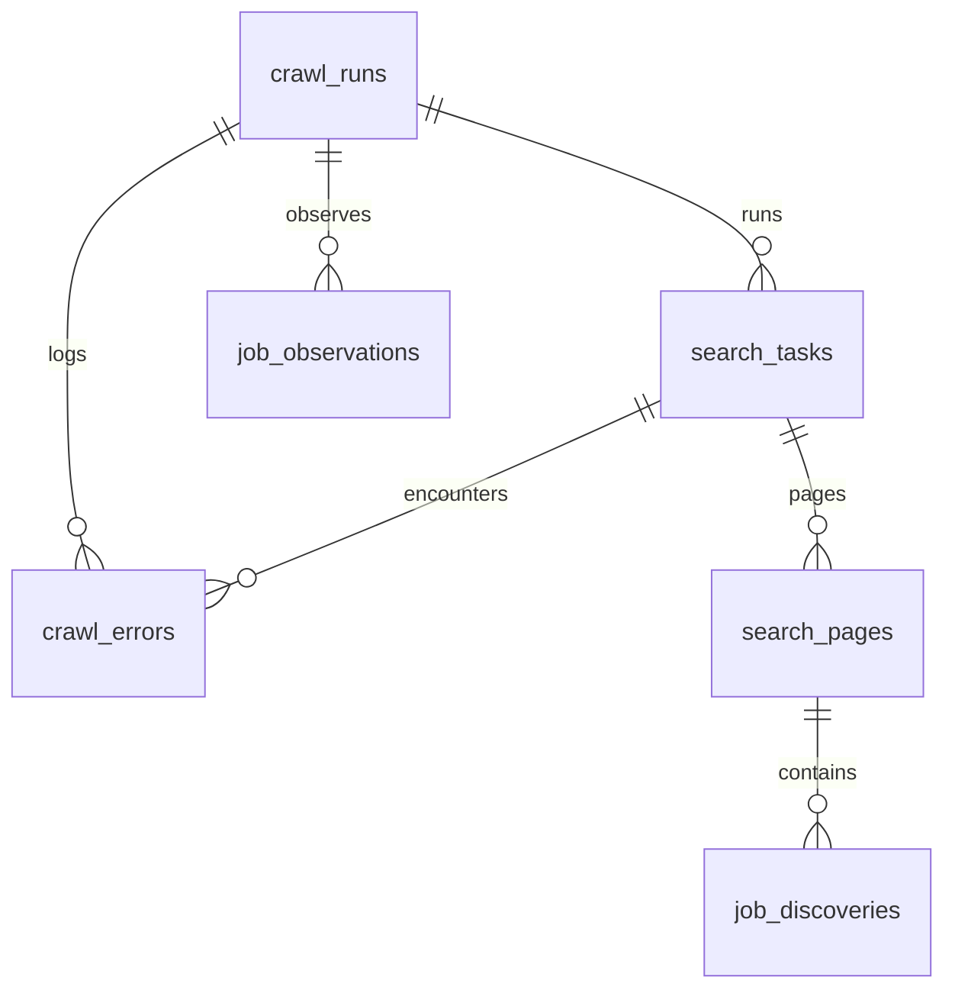

# Raw Storage Architecture — `topcv_raw_storage`

**PostgreSQL database:** `topcv_raw_storage` • **schema:** `raw` • **storage:** JSONB payloads with provenance and immutable observation history.

## Six physical tables

| Table | Grain / key purpose | Important fields |
|---|---|---|
| `crawl_runs` | One crawl run / scheduled slot per scope/day; UUID ID | `crawl_run_id`, `snapshot_date`, `run_status`, `config_sha256`, `run_purpose`, `observation_method`, `schedule_key` |
| `search_tasks` | Search scope within run | `task_id`, `position_id`, `location_id`, `last_completed_page`, `status` |
| `search_pages` | Page attempt captured for a search task | `page_id`, `page_number`, `attempt_number`, `fetch_status`, `listing_items`, `page_html` |
| `job_discoveries` | A job discovered in a listing page | `discovery_id`, `source_job_id`, `task_id`, `page_id`, `listing_payload` |
| `job_observations` | Detail of a job **in a specific run** | `raw_job_id`, `crawl_run_id`, `source_job_id`, `snapshot_date`, `scraped_at`, `content_hash`, `raw_payload` JSONB, `capture_source`, `is_temporal_eligible` |
| `crawl_errors` | Failure/provenance record | `error_id`, `crawl_run_id`, `task_id`, `error_kind`, `stage`, `source_job_id` |

## Relations and flows

**Transaction boundaries:** listing page + discovery records + `last_completed_page` commit together. Detail observations have a uniqueness constraint per `(crawl_run_id,source_job_id)` and are never satisfied by the previous day's detail. Raw retains history across days and carries source timestamp/provenance to cleaning. For completed run, missing current-run details prevent a false success status.

**Crash recovery:** queue in a separate `market` DB stores the Raw run/task pointers. Reconciler uses deterministic scheduled UUIDs and `raw.crawl_runs` to recover a run committed before queue state. A day change closes unfinished old runs rather than attributing captures to the next date. Host cooldown is stored in `market_ops.host_backoff`.

**Raw security:** collector uses an authenticated writer only when source permission exists, DW extractor should be read-only, no DB DSN/cookies inside source or release ZIP. SQL contract: `sql/create_topcv_raw_storage_schema.sql`, code: `src/raw_storage/`.

**Not a star schema.** Raw is evidence/history storage; cleaning and analytical measures belong downstream.
